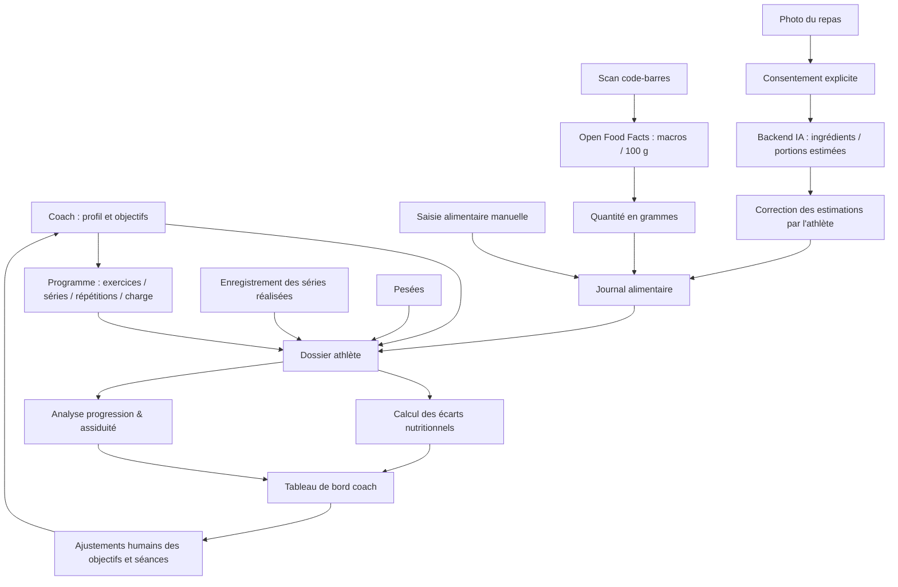
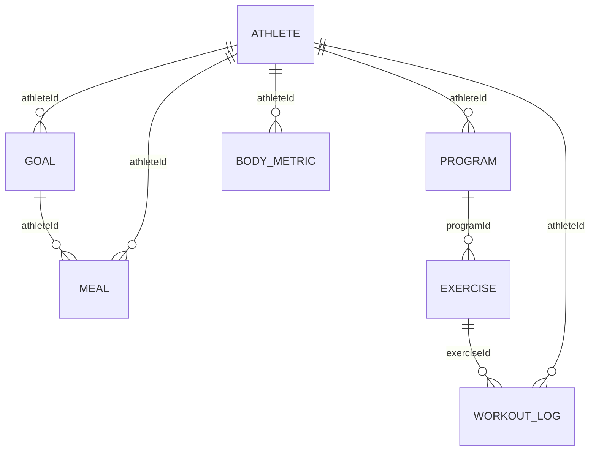
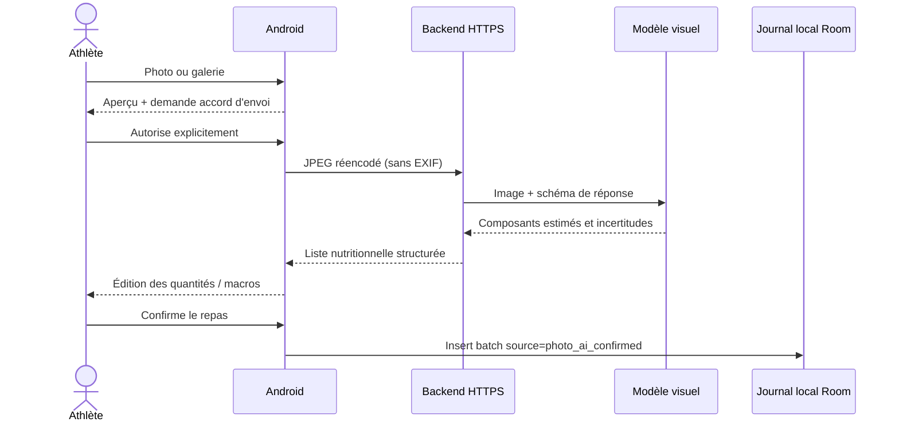

# CoachLink — Architecture technique et fonctionnelle

## Vision
Application Android native pour un coach et ses athlètes. Un dossier athlète commun sert de point de jonction entre :
1. Objectifs nutritionnels prescrits par le coach
2. Journal alimentaire avec calories et macronutriments
3. Catalogue alimentaire (code-barres, base Open Food Facts, édition manuelle et photo IA assistée)
4. Plans d'entraînement attribués par le coach
5. Performances réalisées par l'athlète
6. Mesures corporelles et suivi longitudinal

### Flux complet

## Stack technique
- Kotlin (Android natif), Jetpack Compose, Material 3
- Architecture UI / domaine / données, état réactif Flow
- Room (SQLite) : stockage privé local, compatible hors connexion pour les données déjà enregistrées
- Google Code Scanner (Play Services) : scan de codes-barres, sans autorisation caméra demandée par l'application
- API Open Food Facts v2 (HTTPS) : données nutritionnelles de produits emballés
- Coroutines : appels réseau et enregistrement hors thread principal
- Photo Picker Android et TakePicture avec FileProvider : import photo / capture, sans stocker la photo en base
- Service IA distinct (backend FastAPI sous HTTPS) : analyse image par modèle à capacités visuelles ; secrets sur serveur uniquement
- Validation humaine des portions et des valeurs estimées, puis enregistrement via le journal Room

## Modules et dossiers
- `app/src/main/java/com/coachlink/app/domain/NutritionMath.kt` : calculs purs et validés
- `.../data/LocalDb.kt` : entités Room, DAO, base de données
- `.../data/CoachRepository.kt` : frontière d'accès aux données
- `.../data/OpenFoodFacts.kt` : intégration nutritionnelle externe
- `.../data/PhotoMealAnalysis.kt` : compression locale JPEG, transport HTTPS et validation du JSON IA
- `.../ui/PhotoMealScreen.kt` : caméra, galerie, consentement, tableau de correction, validation
- `backend/app.py` : endpoint HTTP d'analyse de photo et réponse normalisée
- `.../ui/CoachViewModel.kt` : commandes métier, validation, états d'interface
- `.../ui/Screens.kt` : interfaces coach/athlète et scanner

## Schéma des données

**Implémentation MVP** : athleteId=1 / coachId=1 dans la base locale, avec un commutateur de rôle purement visuel. La table ATHLETE du schéma cible n'est pas encore implantée : les identifiants sont des points d'extension. Ce MVP N'EST PAS un système multi-utilisateur et ne fournit pas de contrôle d'accès réel.

### Règles de calcul
- Un aliment est stocké avec ses valeurs *par 100 grammes* : énergie, protéines, glucides, lipides.
- Valeur consommée = valeur pour 100 g × quantité consommée / 100.
- Total journalier = somme des entrées associées à la date.
- Protéines = poids de référence × objectif en g/kg choisi par le coach.
- Lipides = poids de référence × objectif en g/kg choisi par le coach.
- Glucides = (objectif calorique − 4 × protéines − 9 × lipides) / 4.
- Les arrondis en grammes peuvent faire légèrement différer les calories reconstruites des calories cibles.
- Volume d'entraînement simplifié = séries × répétitions × charge en kg. Ce n'est pas une estimation de dépense énergétique.
- Aucun recalcul automatique des calories consommables à partir d'une séance ou d'un poids n'est effectué.

## Fonctionnalités effectivement fournies dans cette V0.2 locale
- Mode coach/athlète **de démonstration**, sur le même appareil.
- Visualisation des apports journaliers et des objectifs en calories/macros.
- Journal alimentaire avec ajout et suppression.
- Saisie manuelle d'un produit et de sa portion.
- Scanner matériel et requête Open Food Facts par code-barres, avec alternative par saisie de code.
- Capture photo et sélection galerie, accord explicite pour l'envoi, aperçu, estimation IA via serveur **à configurer**, édition des composants/quantités/macros et validation utilisateur.
- Migration Room v1 vers v2 pour conserver la provenance des repas (`manual` ou `photo_ai_confirmed`), sans supprimer les données précédentes.
- Calcul et enregistrement des macronutriments par portion.
- Création, suppression des programmes, ajout d'exercices en mode coach.
- Enregistrement de séances réalisées (séries, répétitions, poids, RPE), progression du jour et volume total.
- Enregistrement et consultation de pesées.
- Tableau de bord transversale du coach.
- Calculateur de macros sous contrôle du coach.
- Historique conservé localement dans Room (hors sauvegarde cloud).

## Ce qui n'est PAS encore livré
- Authentification, inscriptions, invitations coach-athlète, délégation d'accès, multi-coachs.
- Synchronisation en temps réel entre appareils, API backend, cloud sécurisé, sauvegarde distante.
- Analyse par IA utilisable sans serveur configuré, compte API ou connexion : **la détection nutritionnelle exige un backend HTTPS et un service IA payant**.
- Calendrier de séances, cycles complexes, entraînement par intervalle et minuteur.
- Reconnaissance d'aliments non emballés automatique ou catalogue recettes.
- Export PDF, notifications, chat, Health Connect, badges, abonnement ou facturation.
- Synchronisation Health Connect, dashboards web, graphiques avancés.
- Tests instrumentés et validation matérielle sur téléphone Android.

## Évolution conseillée pour la V1 multi-athlètes

### Backend
- API sécurisée : Kotlin/Ktor, Spring Boot ou Supabase (PostgreSQL) ; un seul backend doit être choisi.
- Connexion par email/mot de passe, MFA optionnelle ; session avec expiration, rotation de jetons.
- Entités : `users`, `coach_athlete_links`, `athlete_profiles`, `macro_targets`, `food_catalog`, `meal_entries`, `programs`, `program_days`, `exercise_templates`, `prescribed_exercises`, `workout_logs`, `body_metrics`, `coach_notes`.
- IDs stables (UUID), timestamps UTC, zone d'affichage locale, événements datés et non écrasés.
- Permissions contrôlées **côté serveur**, à chaque requête : l'athlète lit ses données ; le coach lit/édite uniquement les athlètes ayant accordé l'accès. Le coach n'accède à aucun autre dossier par simple changement d'ID.
- Liaison coach-athlète par invitation avec consentement, révocation et traçabilité.
- Synchronisation hors ligne : état local, file de mutations, stratégie de conflits, journal d'événements idempotents et synchronisation incrémentale.
- Archivage des objectifs successifs plutôt que remplacer l'historique ; confidentialité et suppression des données sur demande.

### Protection des données
Le dossier contient des informations de santé et de pratiques sportives potentiellement sensibles. Avant production : information claire, base légale et consentement appropriés, minimisation des données, conservation limitée, contrôle des accès, chiffrement au repos/en transit, authentification robuste, export/suppression des données, étude RGPD selon le contexte et évaluation des prestataires.

### Points d'attention scanner
- Google Code Scanner nécessite un appareil compatible Google Play Services ; pour les autres terminaux prévoir ML Kit intégré / caméra personnalisée ou saisie manuelle.
- La base Open Food Facts est participative : données incomplètes ou erronées possibles. Toujours permettre correction et afficher la source.
- Utiliser un User-Agent identifiant clairement l'application et **remplacer l'adresse de contact fictive avant publication**.
- Respecter les conditions de licence et les obligations d'attribution applicables à Open Food Facts.
- Mettre en cache les fiches produits et gérer le quota API (recherches produit limitées).
- Attention : scanner un produit ne mesure pas la masse réellement consommée ; la quantité est saisie par l'athlète.

### Feuille de route
1. MVP local testé sur un appareil Android : parcours repas, programme, performance, pesée.
2. Backend sécurisé et comptes utilisateurs séparés, invitations et droits d'accès.
3. Synchronisation bidirectionnelle, cache produit et historique des corrections.
4. Bibliothèque d'exercices, planification hebdomadaire, progression assistée par le coach.
5. Tableaux de bord longitudinal, exports, notifications et consentements.
6. Déployer et sécuriser la fonctionnalité photo déjà préparée (authentification, confidentialité, suivi qualité, coûts par analyse), puis éventuellement Health Connect.

## Flux spécifique analyse photo V0.2

### Limitations de sécurité du prototype
- Les endpoints fournis **n'ont pas encore de système d'identification utilisateur ni de limitation de débit** : ne pas exposer ce backend publiquement sans passerelle sécurisée.
- La base Room enregistre les valeurs confirmées, **pas le JPEG**. Les photos de capture peuvent temporairement résider en cache privé durant l'édition de l'écran ; elles sont supprimées à sa fermeture.
- La photo sélectionnée depuis la galerie n'est pas modifiée ni copiée dans le journal.
- La confiance exprimée par un modèle n'est pas une probabilité calibrée. Aucune somme calorique dérivée d'une photo ne doit être présentée comme mesure exacte.
- Les résultats provenant d'un modèle visuel et non d'une base nutritionnelle vérifiée peuvent nécessiter la correction manuelle par le coach ou l'athlète.

## Module V0.3 — analyses hebdomadaires

Le calculateur `domain/WeeklyDashboard.kt` reste volontairement indépendant de Room et de Jetpack Compose.
La couche UI transforme les entités persistées `Meal` / `WorkoutLog` / `BodyMetric` en événements simples `FoodRecord` / `ExerciseRecord` / `WeightRecord`.

- Une semaine va du **lundi au dimanche**, et l'affichage peut revenir sur les 52 semaines précédentes.
- Les jours sans repas ne sont **pas intégrés** dans la moyenne des calories/macros (valeurs manquantes ≠ zéro).
- Le volume sportif représente uniquement la charge externe connue ; le nombre de lignes sportives n'est pas un comptage des séances.
- Les données de photo IA sont enregistrées ingrédient par ingrédient avec `source=photo_ai_confirmed` ; le compteur ne prétend donc pas représenter un nombre de repas photographiés.
- La pesée de référence est la dernière pesée au plus tard le dimanche consulté ; la variation hebdomadaire n'apparaît que s'il existe deux mesures dans cette semaine.
- Le prototype utilise l'objectif nutritionnel **actuel** pour calculer les écarts dans les semaines historiques ; l'historisation de versions d'objectifs sera nécessaire pour des rapports coach fiables.
- Aucune migration Room après V0.2 : seules des fonctions d'agrégation et des composants d'affichage ont été ajoutés.
- Future vraie gestion multi-athlètes : remplacer les requêtes `athleteId = 1` du DAO par des requêtes paramétrées et contrôler les permissions via le backend. **Le mode coach ne permet aujourd'hui pas de suivre plusieurs personnes réelles.**

---

## Extension V0.4 — Boucle d'apprentissage comportemental (pas de fine-tuning)

`AthleteSettings` configure sport/nutrition indépendamment (HUMAN/AI), objectif sportif, séances/semaine et point faible. `ExtraWorkout` stocke les exercices réalisés hors programme (RPE, groupe principal, douleur facultative). `Exercise.muscleGroup` identifie les exercices programmés. Le moteur `domain/AdaptiveCoach.kt` prend ces deux historiques et recalcule une proposition **à chaque consultation après saisie** : chevauchement musculaire, fenêtre de récupération conservatrice, priorité au point faible si récupéré et variation de volume suivant l'effort récent. Les notes de l'athlète ont préséance sur toute proposition et aucune séance n'est sauvegardée sans action explicite.

`domain/NutritionCoach.kt` étudie l'historique nutritionnel uniquement sur les jours enregistrés et fait remonter des observations ; les cibles ne changent pas automatiquement. `MealPlanIngredient` décrit une semaine type de produits/quantités. `domain/ShoppingPlanner.kt` parcourt les dates du mois civil ou de la semaine et cumule les ingrédients avec même nom normalisé. La recopie de l'historique journalier vers le menu futur est opt-in et destructrice pour l'ancien menu : confirmation requise.

L'endpoint optionnel `POST /v1/coach/review` (HTTPS uniquement) reçoit une synthèse minimisée des entraînements et objectifs sur demande, jamais une photo ni une identité ; le backend appelle un modèle de langage sur le serveur. Il ne détient pas les clés dans l'APK. Ce backend de référence est **inadapté à un déploiement public sans authentification, consentement documenté, quotas, supervision, protections et politique RGPD**. La version test est **mono-utilisateur local** et non synchronisée.
